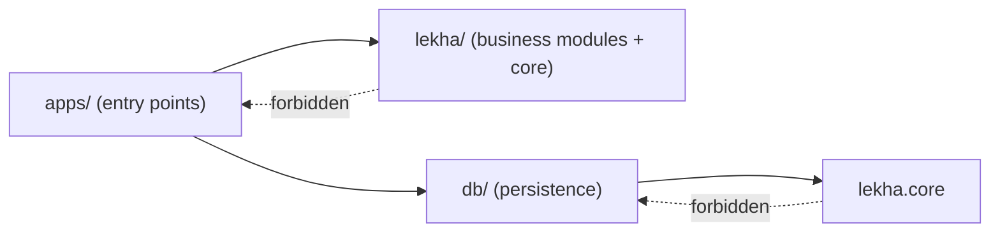

# Architecture overview

Lekha is a **modular monolith** (ADR-0001): one deployable Python application whose
business modules have strict boundaries, so a module could later be extracted into a
separate service without rewriting it.

## Layers

| Layer | Responsibility | Where |
|---|---|---|
| Interfaces | HTTP routes, request/response schemas, middleware, entry points | `apps/` |
| Application | Use cases and orchestration | `lekha/<module>/` (from the schema slice onward) |
| Domain | Business entities, rules, invariants — no framework imports | `lekha/<module>/` |
| Infrastructure | Database, storage, queues, model providers | `db/`, adapters inside modules |
| Platform core | Configuration, logging, health-check runner | `lekha/core/` |

## Current repository layout

```
apps/api/            FastAPI entry point: app factory, middleware, error envelope, health routes
apps/scripts/        Operational scripts (provision the API's least-privilege DB login)
lekha/core/          Validated settings, structured logging, readiness-check runner
lekha/auth/          Access-control vocabulary (classification, badges); pure Python
db/                  Engine (app vs owner account), tenant transactions, Alembic migrations
db/schema/           ORM mappings: identity (org, BU, user, role, grant, badge), documents (doc, version, file, ACL)
db/access.py         Load a caller's AuthContext; the access rule as SQL (readable documents only)
apps/api/auth.py     The sign-in dependency every /api/v1 route uses (fails closed with 401)
apps/api/audit.py    Audit middleware: one append-only event per /api/ request, before the response
lekha/audit/         Audit event vocabulary (outcomes, event shape, sink interface); pure Python
db/audit.py          PostgreSQL audit sink
db/documents.py      Writes for new uploads (document, file, version, guest list)
lekha/memory/        Upload validation (pure), object-store interface, S3 adapter
apps/api/uploads.py  POST /api/v1/documents
apps/api/search.py   POST /api/v1/search, GET /api/v1/ingestion-jobs/{id}
apps/api/ask.py      POST /api/v1/ask: retrieve → prompt → model → verify → log
apps/api/ratelimit.py  Per-user fixed-window limit in Redis (fails closed)
db/answers.py        query_log, answer_log, citation writes; redaction on deletion
apps/api/retrieval.py  Shared retrieval: permission-filtered dense + keyword search, RRF, DB re-check
db/search.py         Keyword (full-text) search, permission rule in SQL
apps/api/meetings.py, db/meetings.py, lekha/ingestion/transcript.py  Meeting memory: import, participant-only access, timed chunks
lekha/generation/    Fixed prompt, citation verifier, abstention (pure)
apps/worker/         ARQ worker: ingestion pipeline (extract → chunk → embed → index → publish) and deletion purge
apps/api/deletions.py  POST/GET /api/v1/deletion-requests
db/deletion.py       Deletion requests, soft delete, purge bookkeeping
lekha/ingestion/     Text extraction, language by script, heading-aware chunking (pure)
lekha/retrieval/     Permission filter from AuthContext; Qdrant adapter with the unscoped-search guard
model_layer/         Language-model interface (Ollama local, Bedrock); embedder interface; fake embedder (simulation); all-MiniLM-L6-v2 (real, English, numpy); BGE-M3 (ONNX Runtime)
apps/api/idempotency.py, db/idempotency.py  Idempotency-Key: claim, replay, complete, release
apps/api/routes_v1.py  /api/v1/me, /api/v1/documents (cursor paging), /api/v1/documents/{id}
frontend/            React + TypeScript web app (Vite dev server proxies /api to the API)
lekha/actions/       Action rules (propose, approve, expiry) and the create_ticket tool spec (pure)
lekha/connectors/    Interfaces to outside systems (ticketing); pure
apps/api/actions.py, db/actions.py, apps/worker/actions.py  Proposals, approvals, execute-once; SIMULATED ticketing system
lekha/speech/        Phone call rules (states, limits, intents, ticket drafts, spoken answers) and phrases in kn/hi/en (pure)
apps/api/voice.py, db/voice.py  Simulated phone line: verification, ask, log, hand-over; SMS outbox (never sent)
apps/scripts/demo_corpus.py, load_demo.py  Synthetic demo corpus and its loader (through the API)
tests/unit/          Fast tests, no Docker required
tests/integration/   Tests against the real local Docker stack
infra/local/         Docker Compose for the local stack
dev.ps1              Repeatable developer commands
```

Not yet created (by design — created when their phase starts): `lekha/mcp` (Phase 6).

### Deviations from the planned structure (CLAUDE.md §4.3)

| Deviation | Reason |
|---|---|
| `lekha/core/` added | Configuration, logging, and health checks are cross-cutting and belong to no business module. |
| `dev.ps1` at the repository root | Windows has no `make`; a root script is the most discoverable entry point. |
| Compose file in `infra/local/` | Keeps local-only infrastructure separate from future production infrastructure in `infra/`. |

## Dependency rules (enforced by `lint-imports`)



- `lekha` and `db` must never import `apps` (entry points depend on business code, never the reverse).
- `lekha.core` must not import `db` (configuration and logging stay free of ORM concerns).
- `lekha.auth`, `lekha.audit`, `lekha.actions`, `lekha.connectors` and `lekha.speech` must not import `db`, `apps`, SQLAlchemy, FastAPI, or any network client: permission and action rules stay pure and unit-testable.
- `model_layer` must not import `lekha` (contract added when `model_layer` is created).

## Request flow (today)

```mermaid
sequenceDiagram
    participant C as Client
    participant M as RequestContextMiddleware
    participant R as Router / handler
    participant H as Readiness runner
    participant D as Postgres / Redis / Qdrant / S3

    C->>M: GET /health/ready (optional X-Request-ID)
    M->>M: accept safe ID or generate one; bind to log context
    M->>R: forward request
    R->>H: run checks concurrently, each with a timeout
    H->>D: SELECT 1 / PING / authenticated GET / health GET
    D-->>H: ok or failure (details logged, never returned)
    H-->>R: per-check status
    R-->>M: 200 ready or 503 not_ready
    M-->>C: response + X-Request-ID header; one structured access-log line
```

Any unhandled exception is caught by the middleware, logged with its stack trace and
request ID, and turned into a generic `500 internal_error` envelope.

## Trust boundaries

1. **Client → API.** All input is untrusted. Today the only inputs are the path, headers,
   and the `X-Request-ID` header (validated against a strict pattern).
2. **API → infrastructure.** Every service requires credentials, binds to `127.0.0.1`,
   and is called with timeouts.
3. **Documents → model** (from Phase 2/3). Document text is data, never instructions.

## Endpoints

| Path | Purpose | Auth |
|---|---|---|
| `GET /health/live` | Process is running; no dependency calls | None (operational) |
| `GET /health/ready` | All dependencies reachable; 503 otherwise | None locally; must be internal-only in production |
| `GET /docs`, `/openapi.json` | API documentation (local/test environments only) | None |

| `GET /api/v1/me` | The caller's identity, roles and clearance per business unit | Signed in |
| `GET /api/v1/documents?limit=&cursor=` | Documents the caller may read (cursor-paged) | Signed in |
| `GET /api/v1/documents/{id}` | One document; `404` if missing **or** not visible | Signed in |
| `POST /api/v1/search` | Permission-filtered search by meaning (`query`, `limit`) | Signed in |
| `POST /api/v1/ask` | Grounded answer with verified citations, or an abstention with its reason; rate-limited per user | Signed in |
| `POST /api/v1/ask/stream` | Same as `/ask`, with progress events (server-sent events); the answer is sent only after its citations are verified | Signed in |
| `GET /api/v1/chunks/{id}` | The full source passage behind a citation; `404` if not readable | Signed in |
| `POST /api/v1/answers/{query_id}/feedback` | Helpful / not helpful (+ comment); only the asker | Signed in |
| `POST /api/v1/meetings` | Import a meeting transcript (.vtt/.srt/.txt + metadata); participants are its only readers; a re-import adds a version | Anyone with a role in the unit |
| `GET /api/v1/meetings`, `GET /api/v1/meetings/{id}` | Meetings you took part in; transcript with times and speakers | Participants |
| `POST /api/v1/meetings/{id}/minutes`, `GET …/minutes` | Draft minutes (decisions, action items, each with a transcript quote); list them | Participants |
| `POST /api/v1/minutes/{id}/approve`, `…/reject` | Approve (optionally edited) or reject; approved minutes become searchable with the meeting | The meeting's organiser |
| `GET /api/v1/glossary` | Glossary entries you can see (your unit's, plus shared ones) | Anyone with a role |
| `POST /api/v1/glossary`, `PATCH`/`DELETE /api/v1/glossary/{id}` | Manage a unit's glossary | Curators of that unit |
| `POST /api/v1/answers/{query_id}/request` | Send an unanswered question to your unit's curators (asker only) | Signed in |
| `GET /api/v1/requests`, `POST /api/v1/requests/{id}/resolve` | Requests in units you curate (plus your own); resolve or dismiss | Curators of the unit |
| `POST /api/v1/actions/propose` | Propose an action (only `create_ticket`); nothing runs until approved; optional `Idempotency-Key` | Anyone with a role in the unit |
| `GET /api/v1/actions`, `GET /api/v1/actions/{id}` | Proposals in units you approve for, plus your own | Signed in |
| `POST /api/v1/actions/{id}/approve`, `…/reject` | Decide (approve with optional edits, re-validated; reject with a reason); the worker then creates the ticket once | `approver` of the unit, never the proposer |
| `POST /api/v1/voice/calls`, `POST …/{id}/say`, `POST …/{id}/hangup`, `GET …/{id}` | SIMULATED phone line (stands in for the telephony webhook): consent, HR number + one-time code, then ask / log / status, or hand-over | None (anonymous until verified); exists only with development sign-in (local/test) |
| `GET /api/v1/voice/outbox`, `GET /api/v1/voice/escalations` | Simulated SMS outbox (never sent) and human hand-over queue | Development sign-in only |
| `GET /api/v1/audit?limit=&cursor=` | Audit trail of activity by people in your audit units | `audit_reader` |
| `GET /api/v1/ingestion-jobs/{id}` | Processing status of an upload | Curator of the unit, or a reader of the document |
| `POST /api/v1/documents` | Upload a PDF/DOCX (multipart `file` + `metadata` JSON); an existing `canonical_key` adds a new version; optional `Idempotency-Key` header for safe retries | Curator in the business unit |
| `POST /api/v1/deletion-requests` | Delete a document: hidden at once, derived data purged by the worker | Curator of the document's unit, cleared for it |
| `GET /api/v1/deletion-requests/{id}` | Status and counts of a deletion | The requester, or a curator of the unit |
