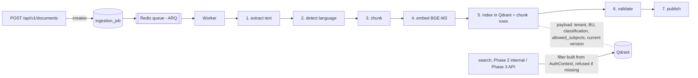

# Phase 2 plan: document ingestion (proposal)

- **Status:** Approved with the recommended D1–D4 (owner, 2026-10-20: "hurry up, at least a
  prototype"). **Prototype built:** steps 1–4 below (worker, extraction, language, chunking,
  fake embedder, Qdrant indexing with permissions, guarded search, job status). Still to do:
  step 5 (versioning and deletion), step 6 (100-document corpus and red-team), the real
  BGE-M3 download (needs owner OK), and the Phase 2 report.
- **Update 2026-10-21:** BGE-M3 downloaded and verified; the red team also passes with it.
- **Update 2026-10-21:** step 6 done: 100-document synthetic corpus (generated deterministically
  in `tests/fixtures/corpus.py` instead of checked-in binaries) and the red-team, 0 anomalies.
  A beta curator (`dev|bina`) was added to the seed to upload beta documents.
- **Update 2026-10-20:** step 5 (versioning and deletion) built and tested. Owner approved
  the BGE-M3 download; the official ONNX export (~2.3 GB) is used with ONNX Runtime instead
  of PyTorch (saves ~2.5 GB). Download in progress on a slow connection.
- **Update 2026-10-20 (owner):** Hindi deferred. Interim real embedder **all-MiniLM-L6-v2**
  (English only, 384 dimensions, CPU, ~90 MB, already on the laptop) via `LEKHA_EMBEDDER=minilm`
  until the BGE-M3 download is possible. Each embedding model uses its own Qdrant collection.
- **Date:** 2026-10-19
- **Scope:** local, **synthetic documents only** (owner's GO of 2026-10-19). No real or confidential data.
- **Sources:** primary plan §4 (Phase 2) and §5 (week 2); Technical Architecture §"Ingestion"
  (stages 1–15), §"Data model" (`chunk`, `ingestion_job`) and the Qdrant payload; CLAUDE.md §8.

## 1. The goal in plain words

Phase 1 can store a file. Phase 2 makes the file **searchable by meaning, without ever
breaking permissions**:

1. **Read the text** out of the PDF or Word file.
2. **Work out the language** (English, Hindi or Kannada).
3. **Cut the text into chunks** of a few paragraphs each.
4. **Turn each chunk into an embedding**: a list of 1,024 numbers that captures its meaning.
5. **Store the embeddings in Qdrant**, each one carrying a copy of the document's guest list.
6. **Refuse any search** that doesn't say who is asking.

There is still no AI answering questions. That's Phase 3.

## 2. What "done" means

From the plan: *"100 real approved documents indexed; 0 permission anomalies on 50-Q
red-team; delete workflow verified end-to-end."* Adapted to the owner's synthetic-only
instruction:

| Criterion | Local version |
|---|---|
| 100 documents indexed | 100 **synthetic** documents (English, Hindi, Kannada; PDF and DOCX) indexed end to end |
| 0 permission anomalies on a 50-question red-team | 50 scripted searches across the synthetic users and business units; **zero** results the asker may not read |
| Delete workflow verified end to end | Deleting a document removes its chunks, embeddings and file, and leaves an audit record; verified by test |
| Searches without permission filters are rejected | Guard test: a search with no `tenant_id` or `allowed_subjects` filter is refused |
| Ingestion status, retries, versioning | Per-stage status visible via `GET /api/v1/ingestion-jobs/{id}`; failed stages retry with backoff; a new version supersedes the old one in the index |

The plan's Phase 2 **release gate** (SSO, audit, backup, red-team, DPDP checklist, processor
contracts) still blocks real data. That stays BLOCKED on Phase 0.

## 3. How it will work

- **Background worker (ARQ on Redis).** Uploads return at once with an `ingestion_job_id`.
  The work happens in `apps/worker/`, a separate process started with `./dev.ps1 worker`.
- **`ingestion_job` table.** One row per document version, recording each stage's status,
  attempts and error code (never document text). Failed stages retry with backoff. Anything
  that keeps failing goes to a `failed` state for review, and the document stays unsearchable.
- **`chunk` table.** Text, heading path, page range, language, token count and the Qdrant
  point ID, per the plan's data model. As the plan states, permissions are **not** stored on
  chunks in Postgres; they are copied into the Qdrant payload at index time.
- **Qdrant collection** `lekha_chunks`, one per organisation in future. The payload follows
  the plan exactly: `tenant_id`, `business_unit_id`, `classification`, `allowed_subjects`,
  `language`, `is_current_version`, `embedding_model`, document/version/chunk IDs. Payload
  indexes go on the filter fields.
- **Permission filter builder** in `lekha/retrieval/`. It is built only from an AuthContext
  and mirrors the Phase 1 access rule: tenant, BU in scope, classification within clearance
  per BU, `allowed_subjects` ∩ badges, current version only. It **raises** if given no context.
  A guard in the Qdrant adapter refuses any query whose filter lacks `tenant_id` and
  `allowed_subjects`.
- **ACL changes and deletion.** If a document's guest list changes, its points' payloads are
  re-written. Deleting a document marks it deleted, removes its points immediately, deletes
  its chunks and file after the retention window (immediately in local dev), and leaves an
  audit record. A test proves a deleted document can't be found.
- **Model layer seam.** `model_layer/embeddings/` defines an `Embedder` interface.
  Implementations: BGE-M3 (real), and a **deterministic fake embedder** used by the unit and
  integration tests, so the tests never download a model or need a GPU (CLAUDE.md §5).

## 4. Decisions I need from you

**D1. Text extraction library.** The plan names Unstructured.io as the default, with pypdf
and python-docx for simple files.
- **Recommendation:** start with **pypdf + python-docx** behind an `Extractor` interface, and
  add Unstructured.io later as a second extractor if real documents need it. Unstructured
  pulls in a very large dependency tree (layout models, OCR tooling) that is hard to install
  on Windows, while our synthetic test documents are simple.
- **Trade-off:** complex layouts, tables and scanned PDFs extract less well until then.
  Scanned PDFs (which need OCR) are refused with a clear status rather than half-read.

**D2. Language detection.** The plan names fastText `lid.176` (a ~126 MB model) plus AI4Bharat
for Indic refinement.
- **Recommendation for now:** detect by **script**. Kannada, Devanagari (Hindi) and Latin
  (English) use different alphabets, so counting characters per script is exact for these
  three languages, needs no download, and is fully testable.
- **Weakness:** Hindi written in Latin letters ("aap kaise ho") would be tagged English.
- Swapping in fastText later is a one-file change behind a `LanguageDetector` interface.

**D3. Downloading BGE-M3 (about 2.3 GB) and how to run it.** Per CLAUDE.md, nothing is
downloaded without your approval.
- **Your laptop:** 15.4 GB RAM (about 2 GB free when checked), 196 GB free on D:, RTX 3050
  with 4 GB VRAM.
- **Model:** about 568 M parameters. In half precision it needs roughly 1.2 GB of GPU memory,
  so it fits the RTX 3050.
- **Runtime:** PyTorch with CUDA is about 2.5 GB more of downloads. A CPU-only setup is
  smaller but slower.
- **Recommendation:** a setting `LEKHA_EMBEDDER=fake|bge-m3` and `LEKHA_EMBEDDER_DEVICE=cpu|cuda`,
  defaulting to **fake**, so nothing heavy is needed until you approve. When you approve, one
  command (`./dev.ps1 fetch-model`) downloads the model into `D:\lekha-ai\models\`
  (git-ignored) and verifies its checksum.

**D4. Synthetic test corpus.** I'll generate about 100 short fake policy documents (HR leave,
travel, safety, IT use) in **English, Hindi and Kannada**, as PDF and DOCX, with clearly fake
names, plus a few prompt-injection documents for later phases. These are checked into
`tests/fixtures/corpus/`, so tests are reproducible.
- **Needs:** two small libraries to *generate* the files, used only in tests and scripts:
  `reportlab` for PDF and `python-docx`, which is also the extractor.
- **Note:** Kannada and Hindi PDFs need a font that covers those scripts (for example Noto
  Sans, which is free). It would be stored in the repo under its open licence.

## 5. Build order (each step small, tested, and merged before the next)

1. **Worker and job tracking:** ARQ worker, `ingestion_job` table, stage dispatcher, retries,
   `GET /api/v1/ingestion-jobs/{id}`. The upload now returns a real `ingestion_job_id`.
2. **Extraction, language and chunking:** extractor interface with pypdf/python-docx (D1),
   script-based language detection (D2), heading-aware 400–800-token chunks with 50-token
   overlap, `chunk` table.
3. **Embeddings and indexing:** `model_layer` embedder interface, fake embedder, BGE-M3 adapter
   (D3); Qdrant collection, payload indexes, ACL propagation; validation and publish stages.
4. **Permission-filtered search (internal) and the guard:** filter builder from AuthContext,
   refusal of filter-less queries, the 50-question permission red-team (0 anomalies).
5. **Versioning and deletion:** a new version supersedes the old in the index; the deletion
   workflow; ACL updates re-written to Qdrant; `POST /api/v1/deletion-requests` (plan endpoint).
6. **Corpus and the 100-document run** (D4), then the Phase 2 report and a stop for your go/no-go.

Commits: **one per step**, pushed only when you say (owner's rule).

## 6. Explicitly not in Phase 2

- The answer-generating AI (Claude/Bedrock or Sarvam) and the public `/api/v1/search` and
  `/api/v1/ask` endpoints: Phase 3.
- OCR for scanned files and the Unstructured.io extractor: deferred (D1).
- Hybrid (keyword + meaning) search and reranking: Phase 3, per the plan's retrieval section.
- Meetings, glossary, connectors, WhatsApp and phone: Phases 4–6.
- Any real or confidential document, and any deployment.

## 7. Risks

- **RAM pressure.** The model plus Docker on 15.4 GB RAM, with about 2 GB free, is tight.
  Mitigation: the fake embedder by default, batch size 8 on GPU, and closing other apps for
  the 100-document run.
- **Windows and CUDA setup** can be fiddly. Mitigation: CPU fallback, so nothing blocks on
  the GPU.
- **Script-based language detection** mislabels romanised Hindi (D2), which is acceptable for
  synthetic data and fixed by fastText later.
