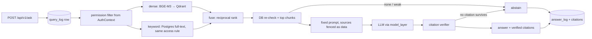

# Phase 3 plan: grounded Q&A (proposal)

- **Status:** Proposed. Waiting for the owner's decisions D1–D6 below.
- **Date:** 2026-10-21
- **Scope:** local, **synthetic documents only** (owner's GO of 2026-10-21). Hindi stays
  deferred.
- **Sources:**
  - primary plan §4 (Phase 3), week 3 (days 11–14), §8 (technical scoreboard), API
    conventions;
  - Technical Architecture: "Retrieval" (steps a–n), "Context assembly", "Generation",
    "Citation extraction and verification", "Abstention", "Query logging", "Evaluation",
    ADR-003 (LLM) and ADR-008 (hybrid retrieval);
  - CLAUDE.md §6 and §8.

## 1. The goal in plain words

Phase 2 can **find** the right pieces of documents. Phase 3 makes Lekha **answer**:

1. A user asks a question at `POST /api/v1/ask`.
2. Lekha finds the best chunks the user may read, using the same permission filter as
   search.
3. It gives those chunks, clearly fenced as *untrusted data*, to a language model (LLM) with
   fixed instructions: answer only from these sources and cite every claim.
4. Lekha **checks every citation**: the quoted words must really appear in the cited chunk.
   Citations that fail are dropped.
5. If the evidence is weak, or no citation survives, Lekha **abstains**: "I do not have
   enough information to answer this."
6. Every question and answer is logged (who, when, which sources, which model), and the log
   is protected like the rest of the data.

**The rule that never bends:** the LLM only ever sees chunks the asker may read. Permissions
are applied *before* the model is involved (CLAUDE.md §6.1).

## 2. What "done" means

The plan's definition of done is *"≥90% citation correctness on 100-Q golden set; 0
permission leaks; p95 answer ≤6s"*. Adapted to local and synthetic data:

| Criterion | Local version | Notes |
|---|---|---|
| Citation correctness ≥ 0.90 | On a **100-question synthetic golden set** (English and Kannada), every citation points at the right document and its quoted span supports the claim | Plan §8 P0 target |
| 0 permission leaks | No answer, citation or log entry ever contains content the asker may not read; red-team questions asked as every synthetic user | Hard blocker |
| Abstention correctness ≥ 0.85 | On the golden set's unanswerable questions (about 20), Lekha says it doesn't know | Plan §8, F-08 |
| Retrieval Recall@10 ≥ 0.80 | The right chunk is in the top 10 for answerable questions | Plan §8 |
| Answer faithfulness ≥ 0.90 | The answer doesn't go beyond its sources (checked by rules on the synthetic facts) | Plan §8 |
| Prompt injection has no effect | Documents carrying instructions can't change answers, reveal other documents or trigger anything | CLAUDE.md §6.2 |
| p95 answer ≤ 6 s | **Measured and reported, but expected to fail on this laptop**: about 20–40 s per answer with the local 9B model. The target applies to production (Claude on Bedrock) | Will be marked BLOCKED, with evidence |

The release gate for real data (SSO, security review, DPDP, processor contracts) stays
BLOCKED on Phase 0.

## 3. How it will work

- **Retrieval** (`lekha/retrieval`):
  - dense search (exists);
  - plus keyword search (D2), which also uses the database access rule, so it can't leak
    either;
  - the two lists are merged with reciprocal rank fusion (k=60, as in the plan);
  - the database re-check from Phase 2 stays.
- **Generation** (`lekha/generation`, pure code with no I/O):
  - **the prompt template** is fixed Python. Only the question and the source blocks vary.
    Each source is wrapped in `<<<source>>> … <<<endsource>>>`, and any fence-like text
    inside a document is neutralised, so a document can't "close" its own fence;
  - **the response schema** is JSON:
    `{"answer", "citations": [{"source": n, "span": "…"}], "abstained", "follow_ups"}`;
  - **the citation verifier** checks that the span appears in source *n* (exact, or exact
    after whitespace normalisation) and drops any that don't;
  - **the abstention gate** abstains when:
    - there are no candidates after permissions;
    - the top retrieval score is below a threshold;
    - the model abstains;
    - the verifier drops every citation.
- **Model layer** (`model_layer/llm`): one `LanguageModel` interface. Adapters are chosen by
  `LEKHA_LLM` (D1, D4). Every call has a timeout and a size limit; an outage gives
  `503 upstream_unavailable`.
- **API:** `POST /api/v1/ask {question}` returns 200 with either an answer and citations, or
  `abstained: true` and a reason (the plan's `abstained` is a body field, not an HTTP error).
  Each citation resolves to document, version, title and chunk; the answer names the version.
- **Logging** (new tables, with tenant row-level security):
  - `query_log`: user, question, language, latency;
  - `answer_log`: model, prompt hash, answer, abstention reason, tokens;
  - `citation`: answer, chunk, document version.

  Question text lives in the database (needed for audit and eval), never in application
  logs.
- **Evaluation** (`tests/eval`, `apps/scripts/eval_answers.py`):
  - a synthetic golden set and corpus;
  - it reports Recall@10, citation correctness, faithfulness, abstention correctness,
    permission violations and latency p50/p95, and writes a markdown report to `docs/eval/`.

## 4. Decisions I need from you

**D1. Which LLM runs locally.** Bedrock (the production default) is blocked on the AWS
account.
- **Recommendation:** use the **local Ollama model already on this laptop** (`qwen3.5:9b`,
  6.6 GB, nothing to download) for development and evaluation, plus a **deterministic fake
  LLM** for automated tests.
  - The fake answers by quoting the best-matching source sentence with a citation, and can
    be told to misbehave (invent a citation, follow an injection) so the verifier and the
    gate are tested.
  - Ollama is reached only at `127.0.0.1`, and cloud model tags (`*:cloud`) are refused, so
    no text leaves the laptop.
  - Measured today: a RAG-sized prompt is read in about 4 s, then about 5.6 tokens/s are
    generated, so about 20–40 s per answer.
- **Alternative:** Claude Haiku through the Anthropic API, as the plan's demo option. It is
  fast and good, but it's a **paid account**, needs a key, and sends (synthetic) text
  abroad. It needs your explicit authorisation (CLAUDE.md §13), so I don't recommend it now.

**D2. Hybrid (keyword + meaning) retrieval now.** The plan says to start dense-only and add
hybrid with before/after evidence (ADR-008).
- **Recommendation:** add it in Phase 3. We already have the evidence: BGE-M3 found only 87%
  of documents by exact reference code (Phase 2 report).
  - Keyword search uses Postgres full-text search with the `simple` configuration, which
    works for Kannada too, since there is no stemmer for it. It needs a migration and an
    index on `chunk`.
  - Measured on the golden set with and without hybrid.

**D3. Reranker** (BAAI/bge-reranker-v2-m3, a second-pass model that reorders results).
- **Recommendation:** **defer.** It's about 2.2 GB more to download on a slow link, and the
  plan calls it optional. Abstention uses retrieval scores instead. Revisit if the golden set
  shows ranking problems.

**D4. Bedrock adapter.**
- **Recommendation:** write the Claude-on-Bedrock adapter now, against the same interface,
  using boto3 (already a dependency). Test it with a stubbed AWS client (contract tests), and
  mark it **untested-live: blocked on the AWS account**. It is never selected locally.

**D5. Minimal web UI.** The plan's week 3 includes "sign in → ask → see cited answer", but
CLAUDE.md puts the pilot UI in Phase 4, and React tooling is a large download.
- **Recommendation:** **defer the UI to Phase 4.** Use the API docs page (`/docs`) to ask
  questions locally. A tiny static page is possible if you want to demo to your manager.

**D6. Golden set.**
- **Recommendation:** a separate **golden corpus of about 40 synthetic policies with
  distinct facts** (English and Kannada; some restricted to particular users; some
  carrying prompt-injection text), plus **100 questions**:
  - about 70 answerable, each with expected source(s) and facts;
  - about 20 unanswerable;
  - about 10 permission and injection probes.
- Answers are written by hand from the generated facts, not produced by the system under
  test.

## 5. Build order (each step tested; one commit per finished step)

1. **Model layer:** `LanguageModel` interface; fake LLM; Ollama adapter (localhost-only,
   JSON mode, timeouts); Bedrock adapter with stubbed contract tests (D4).
2. **Generation core:** prompt template with fencing, response parsing, citation verifier,
   abstention gate. Unit tests include injection attempts and invented citations.
3. **Hybrid retrieval** (D2): full-text index migration, permission-aware keyword search,
   reciprocal rank fusion, and tests that keyword search can't leak.
4. **`POST /api/v1/ask`:** `query_log`, `answer_log` and `citation` tables (migration, RLS);
   per-user rate limit on `/ask` (Redis); 503 on LLM outage; audit.
5. **Golden set and evaluation:** corpus, 100 questions, harness and report. Run with the
   fake LLM in CI and with Ollama by hand, with real numbers recorded.
6. **Phase 3 report** (A–K), then stop for your go/no-go.

## 6. Explicitly not in Phase 3

- Real or confidential documents; any deployment; paid APIs (unless you choose D1's
  alternative).
- Reranker (D3), answer caching, historical "as of date" answers, intent classifier: later,
  each justified by golden-set evidence.
- Web UI (D5), meetings, glossary: Phase 4. Phone, WhatsApp, actions: Phase 5. MCP: Phase 6.
- Hindi (deferred).

## 7. Risks

- **Local model quality,** especially for Kannada answers, may be weaker than Claude.
  Mitigation: the verifier and abstention catch bad citations; the golden set measures it
  honestly; Bedrock or Sarvam come later.
- **Speed:** 20–40 s per local answer. The 100-question evaluation takes about an hour, so
  it's run by hand, not in every test run.
- **RAM:** Docker (about 2.3 GB) + BGE-M3 (about 2.5 GB) + Ollama 9B (about 6–7 GB) on a
  15.4 GB laptop is tight. Close other apps for evaluation runs.
- **Prompt injection** can't be fully prevented by prompting alone. Defence in depth:
  - permission-filtered retrieval;
  - fenced sources;
  - no tools or actions available to the model;
  - the citation verifier.
