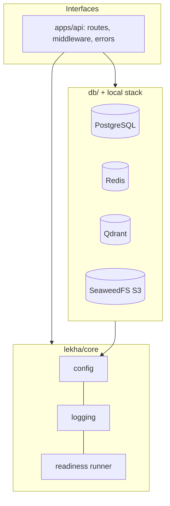

# Phase 1, checkpoint 1: bootstrap and infrastructure skeleton

Date: 2026-10-17. Phase 1 is **not complete**. This report covers the first slice only.

## A. What we built
- A Python 3.12 project with locked dependencies and automated quality checks.
- A local stack of four services (PostgreSQL, Redis, Qdrant, S3-compatible object storage), each password-protected and reachable only from this laptop.
- A FastAPI web application with validated configuration, structured JSON logs, a request ID on every request, one error format for every failure, and liveness and readiness endpoints.
- Database migrations set up (Alembic), but no tables yet.
- PostgreSQL backup and restore commands.
- One script, `dev.ps1`, that runs every developer task.
- Documentation: README, architecture, phase tracker, local-development guide, security notes, and six ADRs.

## B. How the system works
A request arrives → `RequestContextMiddleware` gives it a request ID (it keeps the caller's ID only if that ID is safe) and attaches the ID to every log line → the router runs the handler → for `/health/ready`, Lekha checks all four services at the same time, each with a 2-second limit → it answers 200 "ready" or 503 "not_ready" → the middleware adds the `X-Request-ID` header and writes one access-log line. If the code crashes, the middleware logs the stack trace and returns a generic 500 error that hides the internal details.

## C. Technology decisions
| Tech | What it is / the problem it solves | Why chosen | Trade-off | Where |
|---|---|---|---|---|
| **FastAPI** | A web framework. An *API* is the set of URLs that programs call to talk to Lekha | Async, type-driven validation, automatic OpenAPI docs | Async code is harder to debug | `apps/api/` |
| **Pydantic Settings** | Reads configuration from environment variables and validates it | Refuses to start with bad or placeholder secrets | One more layer to learn | `lekha/core/config.py` |
| **PostgreSQL 16** | Relational database, the system of record | Approved stack; strong constraints and transactions | Needs operating: backups, roles | compose |
| **SQLAlchemy 2 (ORM)** | Maps Python classes to database tables | Approved; mature | Hides SQL, so you must still understand the SQL it runs | `db/` |
| **Alembic (migrations)** | Versioned scripts that change the database schema step by step, like Git for the schema | Reviewable and reversible schema changes | Migrations must be written carefully | `db/migrations/` |
| **asyncpg** | PostgreSQL driver | psycopg's async mode fails on Windows' default event loop (ADR-0004) | Needs care if PgBouncer is added | `db/engine.py` |
| **Redis** | In-memory store; will hold the *job queue* (a to-do list that background *workers* process) from Phase 2 | Approved; ARQ builds on it | Data lives in memory, so we enabled AOF persistence and `noeviction` | compose |
| **Qdrant** | *Vector database*: finds text with a similar meaning by comparing *embeddings* (lists of numbers that represent meaning) | Approved; self-hosted; supports permission filters | Another stateful service to back up | compose |
| **SeaweedFS** | S3-compatible file storage, standing in for MinIO | MinIO images are no longer published (ADR-0005, Proposed) | Not 100% S3-identical | compose |
| **structlog** | Structured logging library | Logs are machine-searchable and every line carries the request ID | Raw JSON is harder to read by eye (the console format is used locally) | `lekha/core/log.py` |
| **uv** | Python and dependency manager | Installs Python 3.12, keeps a reproducible lockfile | Younger tool | `pyproject.toml`, `uv.lock` |
| **ruff / mypy / import-linter / pytest** | Formatting and linting, type checking, module-boundary enforcement, tests | Catch bugs and boundary violations automatically | Stricter checks take more effort up front | `./dev.ps1 check` |

## D. Architecture

Dependencies point inward, and `lint-imports` enforces this. Trust boundaries: client → API (all input is untrusted), API → services (credentials, timeouts, localhost only). Patterns used: the app-factory pattern (`create_app`), dependency injection of readiness checks (so tests can swap them), and middleware.

## E. Files created
`CLAUDE.md` (governing instructions) · `pyproject.toml` / `uv.lock` (dependencies and tool configuration) · `dev.ps1` (commands) · `.env.example` · `infra/local/docker-compose.yml` · `lekha/core/{config,log,health}.py` · `apps/api/{main,middleware,errors,health,readiness}.py` · `db/{engine,base,models}.py` · `alembic.ini` and `db/migrations/` · `tests/unit/*`, `tests/integration/*` · `docs/*`.

## F. Testing and verification (commands actually run)
- `./dev.ps1 setup` → `.env` generated (values redacted when inspected).
- `./dev.ps1 up` → all four containers healthy.
- Manual probes: Qdrant without a key → 401, with the key → 200; Redis without a password → `NOAUTH`; anonymous S3 → 403; `netstat` shows all ports bound to 127.0.0.1 only.
- `alembic upgrade head`, `current`, `check`, and `upgrade head --sql` all succeeded against the real Postgres.
- `./dev.ps1 check` → format OK, ruff OK, mypy "no issues in 26 files", import contracts 2 kept, **30 unit tests passed**.
- `./dev.ps1 test-integration` → **4 passed** (ready with real services; wrong credentials fail closed; statement timeout = 15 s; migrations upgrade, downgrade, and check).
- Ran uvicorn and checked by hand: `/health/ready` returned 200 with the request ID echoed back; an unknown route returned the error envelope; `/openapi.json` returned 200 locally.
- Backup → changed the data → `restore` without `-Yes` was refused → `restore -Yes` brought the database back to exactly its backed-up state.
- A bug found by the tests and fixed: the HTTP client library was logging full URLs, including query strings. Its loggers are now set to WARNING, and a regression test covers it.
- Not done: no CI pipeline, no load testing, no Qdrant or object-storage backups.

## G. Security and operations review
Implemented and tested: fail-closed configuration, masked secrets, credentials on every service, localhost-only ports, no internal details in error responses, no query strings or exception messages in logs, request IDs safe against log injection, timeouts on every dependency call, locked dependencies with a cut-off date, API docs disabled in production.
**Not implemented yet:** authentication, authorization and ACLs, audit log, upload validation, least-privilege database roles (the app currently connects as the database owner, which is acceptable locally only), rate limiting.
Production prerequisites (all open): OIDC, a secrets manager, TLS, internal-only health endpoints, monitoring, data-residency and DPDP review.

## H. Phase 1 acceptance criteria
| Criterion | Result | Evidence |
|---|---|---|
| Repository and application skeleton | PASS | Tree in place; import contracts kept |
| Docker Compose: Postgres, Qdrant, MinIO, Redis | PASS* | *SeaweedFS instead of MinIO; awaiting your approval (ADR-0005) |
| FastAPI application | PASS | Unit and integration tests |
| Validated configuration and local secrets | PASS | `test_config.py`, `setup` |
| SQLAlchemy models and Alembic migrations | FAIL (partial) | Infrastructure tested; no models yet |
| User, document, version, and ACL schema | FAIL (not started) | Needs the Implementation Plan's ACL model |
| Protected boundaries and dev-only auth adapter | FAIL (not started) | Next slice |
| File upload infrastructure and validation | FAIL (not started) | Next slice |
| Audit log infrastructure | FAIL (not started) | Next slice |
| Request-ID correlation | PASS | `test_api.py` |
| Structured logging | PASS | JSON log test |
| Health and readiness endpoints | PASS | Unit and integration tests |
| Basic automated tests | PASS | 30 unit + 4 integration |
| Local backup and restore | PARTIAL | Postgres verified; Qdrant and S3 pending |
| Group OIDC | BLOCKED | Phase 0: IdP access |
| AWS deployment | BLOCKED | Phase 0; not authorised |

## I. Known issues and next steps
1. **The Implementation Plan is missing from the repository.** It is needed for the ACL model and the exact acceptance criteria.
2. ADR-0005 (SeaweedFS) and ADRs 0002–0004 and 0006 need your approval.
3. Next slices: least-privilege database roles → identity and ACL schema → dev-only auth adapter and protected `/api/v1` with isolation tests → append-only audit log → S3 storage adapter and upload validation → Qdrant and S3 backups.
4. Only about 0.9 GB of RAM was free when measured; the containers are capped at about 2.3 GB in total.
5. Technical debt: `app.state` is untyped; readiness checks object-storage liveness only, not its credentials.

## J. Learning notes
- **Liveness vs readiness:** liveness asks "is the process alive?"; readiness asks "can it serve traffic right now?" Keep liveness free of dependency calls, so a database outage doesn't make the orchestrator restart healthy processes.
- **Fail closed:** when something is missing or wrong (a secret, a credential, a permission), refuse to continue. Never fall back to "allow".
- **Request IDs** tie together every log line of one request. Never trust an incoming ID blindly, because it can be used to inject fake log lines.
- **Errors:** log the details on the server, and send the client only a stable code and a generic message.
- **Migrations** are version control for the database schema. Never let the app create tables automatically.
- **Pin versions** (images, packages, lockfile) so that "works on my machine" also works on the next machine.
- **Rejected:** microservices (premature), psycopg async (fails on Windows), floating image tags (silent upgrades), building MinIO from source (we would have to maintain it).
- **Before the next slice:** understand how an ACL (who may see which document) will be stored on documents *and* copied onto every chunk in Qdrant, because search must filter by permission *before* any text reaches the model.

## K. Go/no-go
**NO-GO for completing Phase 1 or starting Phase 2**: the mandatory security criteria (auth, ACLs, audit) are not built yet.
**GO to continue Phase 1** with the next slice, once you approve or adjust ADR-0005 and (ideally) supply the Implementation Plan.
