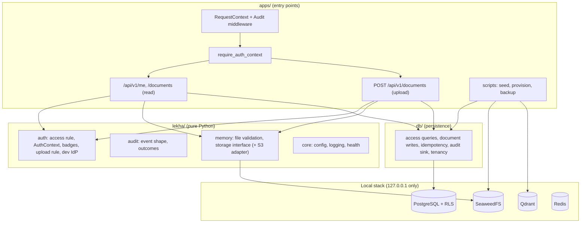

# Phase 1 — Secure foundation: end-of-phase report

- **Date:** 2026-10-19
- **Scope:** local implementation of Phase 1 on the owner's Windows laptop, synthetic data only
- **Code state:** `main` at the merge of slice 7 (45 commits), pushed to the private GitHub repo
- **Earlier checkpoint report:** [phase-1-checkpoint-1.md](phase-1-checkpoint-1.md)

---

## A. What we built

Lekha now has a **secure, tested foundation** that runs entirely on the laptop. There is no
AI yet: no search over meaning and no answers. Those come in Phases 2 and 3. Phase 1 builds
the parts every later phase stands on:

1. **A web API (FastAPI)** with health checks, a tracking number on every request, tidy logs
   that never contain secrets, and one consistent shape for every error.
2. **Four local services in Docker**, each password-protected and reachable only from this
   laptop:
   - PostgreSQL: the main database;
   - Redis: the job queue for Phase 2;
   - Qdrant: the search-by-meaning store, used from Phase 2;
   - SeaweedFS: file storage, the approved stand-in for MinIO.
3. **The data model from the plan:** companies (tenants), business units, users, roles, role
   grants, "badges" (permission subjects), documents, versions, files and guest lists (ACLs).
4. **Permissions that the database itself enforces:**
   - the app connects with a limited account that cannot change the schema;
   - every table filters by company (row-level security);
   - links between tables can never cross companies.
5. **The access rule** (same company, right business unit, cleared for the sensitivity level,
   on the guest list, live current version). It is written once in plain Python, applied
   inside the SQL query, and a test proves the two always agree.
6. **Practice sign-in** with synthetic users, refused outside local/test. The real company
   sign-in (Group OIDC) is blocked until Group IT provides access. Until then, every protected
   page answers "not signed in" outside local/test.
7. **A permanent audit trail:** one entry per API request, written *before* the answer is
   released (if it can't be written, no data is returned). Nobody can edit or delete entries,
   not even the master database account.
8. **Document upload** for curators:
   - PDF or Word only, checked by content rather than by name;
   - macros refused, size-limited, confidential files blocked by the release gate;
   - fingerprinted (SHA-256) and verified by storage;
   - no files left behind when an upload fails;
   - safe retries with `Idempotency-Key`.
9. **Backups of all three data stores** with a checksummed manifest, verify-before-restore, and
   an automated "fire drill" test that wrecks the data and restores it.
10. **Engineering discipline:**
    - a locked dependency set;
    - automated checks (format, lint, strict types, import boundaries);
    - 137 unit and 76 integration tests;
    - 11 ADRs, all approved;
    - one command script (`dev.ps1`) for every task.

## B. How the system works

A request travels through these steps:

1. **RequestContextMiddleware** gives the request an ID (keeping the caller's only if it is
   safe) and attaches it to every log line.
2. **AuditMiddleware** waits for the answer. It writes the audit entry first and only then lets
   the answer go out. If the write fails, the caller gets a generic 500 instead.
3. **The router** sends `/health/*` straight through. Every `/api/v1/*` route first runs
   **`require_auth_context`**:
   - the identity provider (the dev adapter locally) reads the credentials;
   - the user and their active role grants are loaded *inside a tenant transaction*;
   - the result is an immutable **AuthContext**: badges, plus clearance and roles per business unit.
   Anything missing or wrong → `401`, with the same message every time.
4. **The handler** passes the AuthContext explicitly into every data call:
   - **Reading** documents: the access rule is part of the SQL `WHERE`, so forbidden rows never
     leave the database. Missing and forbidden documents both return `404`.
   - **Uploading**:
     1. size check from `Content-Length`;
     2. metadata check;
     3. file check, by content;
     4. permission check (release gate → curator → clearance);
     5. `Idempotency-Key` claim;
     6. store the file (checksum verified by storage);
     7. write the rows in one transaction, deleting the file if that fails;
     8. record the response for replay.
5. **Underneath it all**, PostgreSQL enforces the same company boundary again with row-level
   security. The limited app account cannot bypass it.

## C. Technology decisions

| Technology | What it is / problem it solves | Why Lekha uses it (over alternatives) | Trade-offs | Where |
|---|---|---|---|---|
| **FastAPI** | Python web framework. An *API* is the set of URLs other programs call | Plan baseline; async; validation and OpenAPI docs built in (vs Flask/Django: more manual or heavier) | Async code is harder to debug | `apps/api/` |
| **PostgreSQL 16** | Relational database, the system of record | Plan baseline; constraints, transactions, **row-level security** | Must be operated: backups, roles | compose, `db/` |
| **SQLAlchemy 2 + Alembic** | *ORM*: maps Python classes to tables. *Migrations*: versioned, reversible schema changes, like Git for the database | Plan baseline; reviewable migrations, never auto-created schemas | Hides SQL, so you still must understand it | `db/schema/`, `db/migrations/` |
| **asyncpg** | PostgreSQL driver | psycopg's async mode fails on Windows' default event loop (ADR-0004) | Needs care with PgBouncer later | `db/engine.py` |
| **Row-level security** | Postgres filters rows by a per-transaction setting | Defence in depth (plan): even a buggy query can't cross companies (ADR-0007) | `organisation_id` on every table; composite foreign keys | migrations 0002–0004 |
| **Qdrant** | *Vector database*: finds text with similar meaning by comparing *embeddings* (numbers that represent meaning) | Plan baseline; filter-first search for permissions | Running now, unused until Phase 2 | compose, backups |
| **SeaweedFS** | S3-compatible file storage | MinIO images are no longer published (ADR-0005); same S3 API as production AWS S3 | Not 100% S3-identical; needed a volume-limit fix | compose, `lekha/memory/s3_store.py` |
| **boto3** | Official AWS S3 client | Works with AWS and SeaweedFS unchanged; checksums, retries, timeouts | Synchronous, so it runs in a thread | `lekha/memory/s3_store.py` |
| **Redis** | In-memory store; will hold the *queue*, a to-do list that background *workers* process | Plan baseline (with ARQ in Phase 2) | Memory-based; we set persistence and `noeviction` | compose |
| **structlog** | Structured (JSON) logging | Searchable logs with the request ID on every line | Raw JSON is hard to read by eye (console format locally) | `lekha/core/log.py` |
| **Pydantic / pydantic-settings** | Data validation | Validates config (refuses weak secrets) and API input | — | `lekha/core/config.py`, routes |
| **uv + ruff + mypy + import-linter + pytest** | Package manager, linter, type checker, boundary checker, tests | Reproducible lockfile with a supply-chain cut-off; strict quality gates (ADR-0002) | Stricter checks cost effort up front | `pyproject.toml`, `dev.ps1 check` |
| **Docker Compose** | Runs the four services locally | Plan baseline; reproducible and isolated (ADR-0003) | Docker Desktop on Windows can be fragile (see I) | `infra/local/` |

*Authentication* (proving who you are) is the dev adapter today and Group OIDC later.
*Authorisation* (what you may do) is the access rule plus row-level security.

## D. Architecture

- **Dependency rules, enforced by `lint-imports` on every check:**
  - entry points may import business code, never the reverse;
  - `lekha.core` never imports `db`;
  - `lekha.auth` and `lekha.audit` import no framework, database or network library;
  - the upload validators and the storage interface import no S3 SDK or framework.
- **Trust boundaries:**
  1. client → API: all input untrusted, validated and size-limited;
  2. API → database: limited account plus row-level security;
  3. API → storage: credentials, ID-only keys, checksums;
  4. (from Phase 2) document text → model: data, never instructions.
- **Patterns used:**
  - app factory (`create_app`) with dependency injection of stores and sinks for tests;
  - middleware for cross-cutting concerns;
  - fail-closed defaults everywhere;
  - one rule with two enforcements (Python and SQL), tested for agreement.

## E. Files created or changed (key ones)

| Path | Purpose |
|---|---|
| `CLAUDE.md` | Master engineering instructions (owner's text, word for word) plus current position |
| `docs/implementation-plan/` | The supplied Lekha Implementation Plan (source of truth) |
| `docs/adr/0001–0011` | Architecture decisions, all Accepted |
| `docs/design/permissions-v1.md` | Approved permissions design |
| `docs/phase-tracker.md`, `security.md`, `architecture.md`, `local-development.md` | Live status, controls, structure, how-to |
| `infra/local/docker-compose.yml` | The four local services |
| `dev.ps1` | `setup`, `up`, `migrate`, `seed`, `run`, `check`, `test(-integration)`, `backup`, `verify-backup`, `restore`, `down` |
| `apps/api/` | App factory, middleware, auth dependency, read routes, upload route, idempotency helper, errors, health |
| `apps/scripts/` | DB-login and bucket provisioning, synthetic seed, backup/restore |
| `lekha/auth/` | Access rule, AuthContext, badges, upload rule, identity providers |
| `lekha/audit/`, `lekha/memory/`, `lekha/core/` | Audit vocabulary; file validation and storage; config, logging, health |
| `db/` | Engine (app vs owner), schema, migrations 0001–0004, tenancy, access queries, writes, audit sink, idempotency |
| `tests/unit/`, `tests/integration/` | 137 unit tests; 76 integration tests against the real stack |

## F. Testing and verification

Commands run on `main` on 2026-10-19 for this report:

| Command | Result |
|---|---|
| `./dev.ps1 check` (ruff format + lint, mypy strict on 78 files, 4 import contracts, unit tests) | All pass; **137 unit tests passed** |
| `./dev.ps1 test-integration` (fresh `lekha_test` DB and `lekha-test` bucket) | **76 passed** in 75 s |
| `alembic current` on the dev DB | `0004 (head)` |
| `docker ps` | 4 containers healthy, all on `127.0.0.1` |
| Live walk-through on the dev stack | Readiness: all four `ok`. Upload `201`; retry with the same key `201`, `Idempotent-Replayed: true`, same document. Asha `200`, Ravi `404`, anonymous `401`. All five requests in the audit log |
| `./dev.ps1 backup` + `verify` | Backup written; **5/5 files match the manifest** |

What the integration suite proves, among other things:
- isolation between users and between business units, through the API;
- SQL-vs-rule agreement on the whole synthetic matrix;
- row-level security read and write isolation, with no tenant leaking across pooled
  connections;
- the app role cannot change the schema;
- the audit log is append-only even for the owner, and data is withheld when the audit write
  fails;
- every upload rejection stores nothing; orphan clean-up after a race;
- idempotency replay, clashes and five-way concurrency;
- the full restore drill, and a damaged backup refused with nothing changed.

**Bugs found by testing and fixed during the phase** (each now has a regression test or guard):
1. An HTTP client logged full URLs, including query strings.
2. A provisioning error printed a local password. Errors now hide SQL values, and the password
   was rotated.
3. Integration tests were wiping the dev database. They now use a separate `lekha_test`.
4. `INSERT … RETURNING` was blocked by row-level security for unauthenticated audit events.
5. Uploads leaked their temporary files.
6. SeaweedFS was limited to 8 volumes, which meant only one bucket.
7. Windows reserved the Postgres port after a restart. All ports moved below 49152.
8. Interrupted backups could look complete. They are now written as `.partial`.

**Not verified / not done:** no CI pipeline (all checks run locally), no load testing, no
penetration test, no real identity provider, no AWS environment.

## G. Security and operations review

| Area | Implemented and tested (local) | Placeholder / production prerequisite |
|---|---|---|
| Authentication | Dev-only adapter, refused outside local/test; fails closed with `401` | **Group OIDC**: blocked on Phase 0 IdP access; sessions in Redis per the plan |
| Authorisation | Access rule in SQL; tenant RLS; composite tenant foreign keys; badge integrity checks; curator rule for uploads | Audit reader endpoint (`audit_reader` role) not built |
| Audit | Every `/api/` request; before the response; append-only for all roles; tenant-isolated | WORM export, retention purge procedure |
| Secrets | Random local secrets in `.env` (git-ignored); weak or placeholder secrets refused; values masked in logs and errors | AWS Secrets Manager / Vault |
| Data | Synthetic only; confidential uploads blocked by the release gate | Legal/DPDP review, processor contracts, data-residency verification |
| Uploads | Content-based type check, macro refusal, size limits, checksums, ID-only keys | Malware scanning; SSE-KMS and bucket policies in S3 |
| Failure handling | Timeouts on every dependency; generic errors; fail-closed audit; orphan clean-up; safe retries | Rate limiting (planned per the plan's conventions) |
| Backups | All three stores, checksummed, verify-before-restore, automated drill | RDS point-in-time recovery, S3 versioning in India, scheduled drills with RTO/RPO |
| Observability | Structured JSON logs with request and user IDs; health and readiness | Prometheus, Grafana, Loki, Langfuse (plan day 15, AWS staging) |
| Network | Every service on `127.0.0.1` with credentials | TLS everywhere; health endpoints internal-only |

**Nothing here is a production release.** DPDP compliance is not claimed.

## H. Acceptance criteria

Primary plan, Phase 1 "Done when": *"A user signs in via SSO; audit log captures every
request; backup + restore tested."* CLAUDE.md §8 local list:

| Criterion | Result | Evidence |
|---|---|---|
| A user signs in via **SSO** | **BLOCKED** | Group IdP access is a Phase 0 dependency. Local substitute: dev sign-in, tested (`test_dev_auth.py`, `test_api_isolation.py`) |
| Audit log captures every request | **PASS** | `test_every_api_request_is_audited_with_correlation`, `test_audit_log.py`, live walk-through |
| Backup + restore tested | **PASS** (local) | `test_full_restore_drill`, damaged-backup refusal, live backup verified 5/5 |
| Repository and application skeleton | **PASS** | Planned layout; 4 import contracts kept |
| Docker Compose: Postgres, Qdrant, MinIO, Redis | **PASS** | SeaweedFS replaces MinIO (ADR-0005, Accepted); 4 healthy containers |
| FastAPI application | **PASS** | Unit and integration suites |
| Validated configuration and local secrets | **PASS** | `test_config.py`, `dev.ps1 setup` |
| SQLAlchemy models and Alembic migrations | **PASS** | 0001–0004; upgrade/downgrade/check in tests |
| User, document, version, ACL schema | **PASS** | `test_schema_security.py` (incl. RLS guard on every tenant table) |
| Protected boundaries + dev-only auth adapter | **PASS** | Router-level auth; `test_dev_auth.py`; isolation suite |
| File upload infrastructure and validation | **PASS** | `test_uploads.py`, `test_upload_validation.py`, `test_idempotency.py` |
| Audit log infrastructure and request-ID correlation | **PASS** | Audit tests; request-ID tests |
| Structured logging | **PASS** | `test_logs_are_json_correlated_and_free_of_secrets` |
| Health and readiness endpoints | **PASS** | Readiness checks all four stores, including storage credentials |
| Basic automated tests | **PASS** | 137 unit + 76 integration |
| Backup and restore procedures (local) | **PASS** | ADR-0010; drill test |
| Plan day 15: AWS staging deploy, Prometheus/Grafana | **BLOCKED** | No AWS account or authorisation (Phase 0) |
| Group OIDC integration | **BLOCKED** | Phase 0 |

## I. Known issues and next steps

**External dependencies (Phase 0, owner/IT/Legal):**
- Group IdP (OIDC) client registration;
- AWS Mumbai account;
- Bedrock and Sarvam contracts;
- DPDP legal review;
- the pilot business unit and the Clavis scope.

**Gaps and technical debt:**
1. **Error envelope differs slightly from the plan.** The plan has `detail: {…}`; we use a
   `details` list plus `request_id`. The fix is small, but it changes the API shape, so it
   should happen before any client exists.
2. **Audit reader endpoint** (`GET /api/v1/audit`, `audit_reader`, scoped by business unit)
   is not built.
3. **No CI pipeline** yet (GitHub Actions is in the plan budget). All checks run locally.
4. Rate limiting is not built. The idempotency purge job waits for the Phase 2 worker.
5. Git warns about line endings (LF vs CRLF) on Windows; a `.gitattributes` file would settle it.
6. Uploads are held in memory up to 25 MiB; no malware scanning.

**Risks:**
- Windows/Docker fragility on the laptop (one crash and one port reservation this phase,
  both resolved);
- the plan's own top risk, an understaffed team;
- the DPDP deadline (13 May 2027).

**Phase 2 preview (not started):** upload → extract → detect language → chunk → embed
(BGE-M3) → index in Qdrant with `allowed_subjects` → search refuses any query without a
permission filter. Before starting, choose how to load BGE-M3 on this laptop. It needs about
2.3 GB of disk and runs on CPU or the RTX 3050 (4 GB). Nothing is downloaded without your
approval.

## J. Learning notes (for your notebook)

- **Fail closed.** When anything is missing (identity, filter, secret, audit write), refuse.
  Every Lekha layer works this way.
- **Defence in depth.** Permissions are enforced by the SQL query *and* by row-level security
  underneath. If one has a bug, the other still holds.
- **One rule, two places, one test.** The access rule exists as Python (easy to read and test)
  and as SQL (fast and safe), and a test proves they always agree.
- **Least privilege.** The app's database account can only touch rows. Migrations use a
  different account. A leaked app password cannot drop a table.
- **Untrusted input is checked by content.** File names and claimed types lie; magic bytes and
  structure don't.
- **Order of side effects matters.** Store the file, then write the rows. If the rows fail,
  delete the file. Never leave a row pointing at nothing.
- **Idempotency** makes retries safe: the same request with the same key does the work exactly once.
- **Backups only count if restore works.** That's why the drill test destroys data and checks
  it came back.
- **Rejected alternatives and why:**
  - microservices: premature;
  - psycopg async: fails on Windows;
  - building MinIO from source: we'd maintain it ourselves;
  - writing rows before storing: dangling references;
  - application-only filtering: one bug from a leak;
  - Docker volume tarballs: not verifiable.
- **Before Phase 2, understand:**
  - what an embedding is;
  - why every chunk in Qdrant must carry its permissions (`allowed_subjects`), and why search
    must *reject* queries with no permission filter;
  - why document text must never be treated as instructions (prompt injection).

## K. Go/no-go recommendation

**Mandatory security criteria:** none fail. Authentication, authorisation, isolation, audit,
secrets handling, upload validation and backup/restore are implemented and tested locally.
Two criteria are **BLOCKED**, not failed: real SSO, and AWS staging with monitoring. Both wait
on external Phase 0 access.

**Recommendation:**
- **GO** for Phase 2 *local development*, with synthetic, non-confidential documents only.
  First fix the error-envelope shape (gap 1), and ideally add CI (gap 3).
- **NO-GO** for any real or confidential data, any pilot users, or any deployment. These need
  Group OIDC, the AWS environment, the security review and the Phase 2 release gate (SSO, audit,
  backup, red-team, DPDP checklist, processor contracts), exactly as the plan states.

I am stopping here. Phase 2 will not start until you explicitly approve it.
